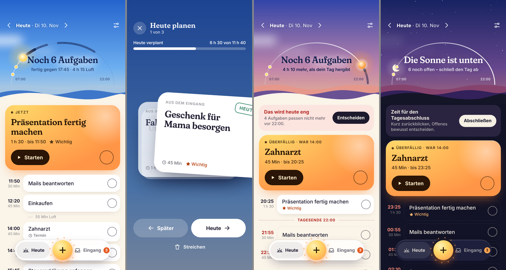

# Tagwerk

Ein persönlicher Tagesplaner als Web-App fürs iPhone. Der Tag ist ein Sonnenbogen:
Was du dir vornimmst, liegt als Abschnitt auf dem Bogen, was du schaffst, leuchtet.
Der Himmel folgt deiner Tageszeit – vom Sonnenaufgang bei Tagesbeginn bis zur Nacht.



Reines HTML/CSS/JavaScript, kein Build-Schritt, keine Abhängigkeiten, keine Server.

## Was die App macht

- **Schnell notieren** – Tippe auf die Sonne. `Sport 45 min um 18:00` füllt Dauer und Uhrzeit von selbst aus, `!` am Ende markiert als wichtig, `morgen` am Ende legt es auf morgen.
- **Uhrzeiten rechnet die App** – Du gibst nur Reihenfolge und Dauer vor. Tagwerk plant ab jetzt durch, baut feste Termine ein, füllt Lücken davor und sagt dir, wann du fertig bist.
- **Ehrliche Kapazität** – Passt nicht alles vor dein Tagesende, siehst du das sofort und entscheidest bewusst.
- **Verschieben kostet etwas** – Jede Aufgabe zählt mit, wie oft sie verschoben wurde. Ab dem dritten Mal fragt die App nach: jetzt 10 Minuten anfangen, trotzdem verschieben oder streichen.
- **Tag planen / Tag abschließen** – Karte für Karte nach links oder rechts wischen. Liegengebliebenes rutscht nie stillschweigend weiter.
- **Fokus-Timer** – Eine Aufgabe, ein Countdown.
- **Wiederholungen** – täglich, werktags, wöchentlich.
- **Offline** – läuft nach dem ersten Öffnen ohne Internet.

## Auf GitHub Pages veröffentlichen

1. Im Repository auf **Settings → Pages** gehen.
2. Unter **Build and deployment → Source** „Deploy from a branch“ wählen.
3. Den Branch mit diesen Dateien und den Ordner `/ (root)` auswählen, **Save**.
4. Nach ein bis zwei Minuten ist die App unter `https://<dein-name>.github.io/<repo>/` erreichbar.

## Aufs iPhone holen

1. Die Adresse in **Safari** öffnen (nicht in einem anderen Browser).
2. Teilen-Symbol → **Zum Home-Bildschirm**.
3. Ab jetzt über das Icon starten – dann läuft Tagwerk im Vollbild wie eine normale App.

Wichtig: Die Daten der Home-Bildschirm-App sind von Safari getrennt. Lege deine Aufgaben also erst an, nachdem du die App installiert hast.

## Gut zu wissen

- **Daten liegen nur auf dem Gerät** (localStorage). Kein Konto, keine Synchronisation. Unter „Rückblick → Daten“ kannst du eine Sicherung speichern und wieder laden.
- **Keine Erinnerungen bei geschlossener App.** Benachrichtigungen bräuchten einen eigenen Server; den gibt es hier bewusst nicht.
- **Updates** kommen nach einer Änderung im Repository beim zweiten Öffnen der App an (die App startet zuerst aus dem Offline-Speicher und aktualisiert sich im Hintergrund).

## Aufbau

```
index.html            Grundgerüst
css/app.css           Gestaltung
js/store.js           Daten, Zeitrechnung, Tagesplanung
js/sky.js             Himmel und Sonnenbogen
js/app.js             Oberfläche und Abläufe
sw.js                 Offline-Speicher
manifest.webmanifest  App-Angaben
icons/, fonts/        Icon und Schrift (Fraunces, SIL Open Font License)
```

Lokal ausprobieren: `python3 -m http.server` im Projektordner starten und `http://localhost:8000` öffnen.
